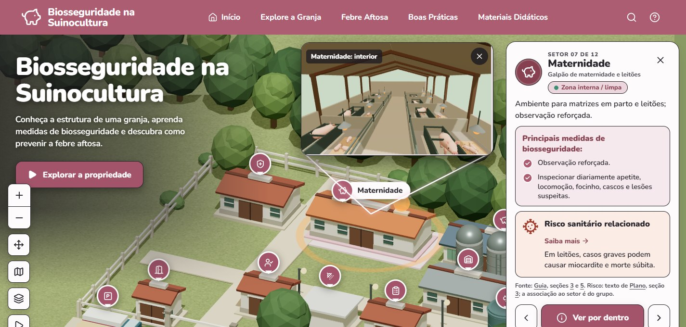

# Biosseguridade na Suinocultura

Uma visita virtual a uma granja fictícia para estudar a prevenção da febre aftosa em suínos. A maquete reúne **12 setores**. Ao selecionar um deles, você descobre o que acontece ali, quais cuidados fazem parte da rotina e onde encontrar a explicação no material do grupo. Cada setor tem a sua própria animação na maquete e abre uma janelinha que mostra, por dentro, o processo que acontece no local.



## Um roteiro pela granja

1. Selecione **Explorar a propriedade** para começar pelo primeiro setor. Arraste a maquete para girar a câmera e use as setas **←** e **→** para passar de uma ficha à seguinte.
2. Observe a janelinha do setor: na portaria a cancela sobe para o visitante registrado, na barreira sanitária a pessoa troca de roupa e toma banho, na quarentena os animais ficam em baias separadas. Em maternidade e creche, escolha **Ver por dentro** para abrir o galpão em corte, cada um com o seu modelo.
3. Selecione o botão ▶ da maquete para ver a **animação passo a passo**: o caminhão chega, a ração segue dali, depois pessoas, animais e resíduos percorrem seus trajetos, uma etapa continuando a anterior.
4. Abra a **planta 2D** para localizar os setores. Ative **Mostrar zonas** e **Mostrar fluxos** e, na legenda, selecione um percurso por vez para acompanhar a circulação de pessoas, animais, ração, veículos ou resíduos.

## Da visita à simulação

Em **Materiais Didáticos**, a simulação apresenta uma suspeita de febre aftosa. Você escolhe como agir, lê a explicação e avança para a próxima etapa. O quiz encerra a visita com cinco perguntas e uma revisão das respostas. O banner acadêmico em PDF e os links nas fichas permitem consultar as fontes durante o estudo.


## Rodar no seu computador

Com Git, Node.js 22.12+ e npm instalados, execute:

```sh
git clone https://github.com/rckhz/biosseguridade-suina.git
cd biosseguridade-suina
npm ci
npm run dev
```

Abra o endereço local que o Vite mostrar no terminal. Para gerar a versão de produção em `dist/`, execute `npm run build`. Os dois comandos também preparam as versões dos documentos que o site exibe no navegador.

A interface foi feita com React e a maquete usa Three.js com React Three Fiber. O conteúdo e as fichas dos setores ficam em [src](src/), e os documentos originais estão em [material-didatico](material-didatico/).

## Créditos

Trabalho acadêmico *Plano de biosseguridade contra doenças emergentes: febre aftosa em suínos*, de Barbara de Castro Piauilino, Ellen Maria Rodrigues Silva, Milena Antônia Ferreira Corrêa Colaço, Milena Moiteiro Silva dos Santos e Victoria Luisa Acosta Mosquetti, com orientação de Andrea Parra e Renato Bueno Flores.
